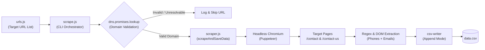

# Phone and Email Scraper

[](./.github/workflows/ci.yml)
[](./package.json)
[](./package.json)
[](./LICENSE)
[](https://www.conventionalcommits.org/)

A lightweight, fault-tolerant Node.js and Puppeteer CLI utility that validates target domains via DNS, visits website contact pages in headless Chromium, extracts phone numbers and email addresses, and appends structured records to a CSV file.

---

## ⚡ Quick Start

Run the scraper locally in 3 commands:

```bash
# 1. Clone the repository
git clone https://github.com/digitalterrene/phone-and-email-scraper.git
cd phone-and-email-scraper

# 2. Install dependencies (downloads compatible Chromium binary via Puppeteer)
npm install

# 3a. Run the CLI batch scraper (reads target URLs from urls.js)
node scrape.js

# 3b. OR start the REST API server & interactive Swagger UI (no Postman/Thunder Client needed)
npm start
# Open http://localhost:3000/docs in your browser to test endpoints live!
```

Extracted records are appended to [`data.csv`](./data.csv) in the repository root.

---

## 🌐 Interactive API & Swagger UI

Start the API server with `npm start` (or `node server.js`) and visit **[http://localhost:3000/docs](http://localhost:3000/docs)** to explore and test every endpoint directly in your browser — no Postman or Thunder Client required.

- 📘 **[API Walkthrough & Endpoint Guide](./docs/api/README.md)**
- 📄 **[OpenAPI 3.0 Specification](./docs/api/openapi.yaml)**
- 🧪 **Live Endpoints**: `GET /api/health`, `POST /api/validate-domain`, `POST /api/scrape`, `POST /api/scrape/batch`, `GET /api/results`, `DELETE /api/results`

---

## 🏗️ System Architecture



### Documentation Architecture (4-Tier Standard)

This repository follows the **4-Tier Documentation Architecture**:

| Tier | Focus | Documents |
|---|---|---|
| **Tier 1: Front Porch & Governance** | Onboarding, rules, legal, security | [`README.md`](./README.md), [`CONTRIBUTING.md`](./CONTRIBUTING.md), [`SECURITY.md`](./SECURITY.md), [`LICENSE`](./LICENSE), [`docs/git-standards.md`](./docs/git-standards.md) |
| **Tier 2: Architectural Blueprints** | Topology, sequences, data contracts, API, threat model | [`System Design`](./docs/architecture/system-design.md), [`Data Model & Extraction`](./docs/architecture/data-model.md), [`Security & Compliance`](./docs/architecture/security-and-compliance.md), [`API Walkthrough`](./docs/api/README.md) |
| **Tier 3: Decision Log (ADRs)** | Immutable historical technical trade-offs | [`ADR Index`](./docs/adr/README.md), [`ADR-001`](./docs/adr/ADR-001-headless-browser-scraping-with-puppeteer.md), [`ADR-002`](./docs/adr/ADR-002-dns-preflight-validation-and-fault-isolation.md), [`ADR-003`](./docs/adr/ADR-003-append-mode-csv-persistence.md), [`ADR-004`](./docs/adr/ADR-004-rest-api-and-interactive-openapi-docs.md) |
| **Tier 4: Operational Runbooks** | Execution verification & incident triage | [`Execution & Verification`](./docs/runbooks/execution-and-verification.md), [`Troubleshooting & Incident Response`](./docs/runbooks/troubleshooting-and-incident-response.md) |

---

## 🛠️ Tech Stack & Repository Structure

| Component | Technology | Version | Purpose |
|---|---|---|---|
| Runtime | Node.js (CommonJS) | `>= 16.x` | CLI orchestration, REST API & DNS pre-flight checks |
| HTTP & Interactive Docs | `express`, `swagger-ui-express`, `js-yaml` | `latest` | REST API server & built-in Swagger UI at `/docs` |
| Browser Automation | `puppeteer` | `^23.10.4` | Headless Chromium rendering and DOM evaluation |
| Persistence | `csv-writer` | `^1.6.0` | Append-mode structured CSV row serialization |
| Core Modules | `dns.promises`, `URL` | Node built-in | Hostname parsing and pre-launch DNS resolution |

```text
phone-and-email-scraper/
├── server.js                                  # Express REST API & Swagger UI (/docs)
├── scrape.js                                  # CLI entry point, DNS validation, URL loop
├── scraper.js                                 # Puppeteer lifecycle, extraction logic, CSV writer
├── urls.js                                    # Input target URL registry
├── data.csv                                   # Output CSV file (appended during execution)
├── .env.example                               # Environment variable template (PORT, CSV_OUTPUT_PATH)
├── package.json                               # Project metadata and dependencies
├── README.md                                  # Tier 1: System overview & quick start
├── CONTRIBUTING.md                            # Tier 1: Contribution workflow & standards
├── SECURITY.md                                # Tier 1: Vulnerability disclosure & SLAs
├── LICENSE                                    # Tier 1: MIT License
├── .github/
│   ├── PULL_REQUEST_TEMPLATE.md               # Standardized PR verification checklist
│   ├── ISSUE_TEMPLATE/
│   │   ├── bug_report.md                      # Structured bug report template
│   │   └── feature_request.md                 # Structured feature/ADR proposal template
│   └── workflows/
│       └── ci.yml                             # Automated CI quality gate
└── docs/
    ├── git-standards.md                       # Branching, Conventional Commits & CoT rules
    ├── api/
    │   ├── README.md                          # Interactive Swagger UI & endpoint walkthrough
    │   └── openapi.yaml                       # OpenAPI 3.0.3 single-source-of-truth spec
    ├── architecture/
    │   ├── system-design.md                   # Component topology, sequences & fault isolation
    │   ├── data-model.md                      # Input/output schemas & extraction pipeline
    │   └── security-and-compliance.md         # Threat model, sandboxing & PII/ethical guidance
    ├── adr/
    │   ├── README.md                          # ADR index & lifecycle diagram
    │   ├── ADR-000-template.md                # Standard MADR/Nygard template
    │   ├── ADR-001-headless-browser-scraping-with-puppeteer.md
    │   ├── ADR-002-dns-preflight-validation-and-fault-isolation.md
    │   ├── ADR-003-append-mode-csv-persistence.md
    │   └── ADR-004-rest-api-and-interactive-openapi-docs.md
    └── runbooks/
        ├── execution-and-verification.md      # Local smoke testing & verification runbook
        └── troubleshooting-and-incident-response.md # Failure triage & diagnostics runbook
```

---

## ⚙️ Configuration & Customization

### 1. Configure Target URLs (`urls.js`)

Edit [`urls.js`](./urls.js) to export the base URLs to scrape (include protocol `http://` or `https://`, without trailing slashes):

```javascript
const urls = [
  "https://www.example1.com",
  "https://www.example2.com",
];

module.exports = { urls };
```

### 2. Customize Target Sub-Paths (`scraper.js`)

By default, [`scraper.js`](./scraper.js) visits `/contact` and `/contact-us` for each base URL. Update `pagesToScrape` to include additional paths:

```javascript
const pagesToScrape = [
  `${url}/contact`,
  `${url}/contact-us`,
  `${url}/about`,
];
```

### 3. Change Output CSV Destination (`scrape.js`)

Update the second argument passed to `scrapeAndSaveData` in [`scrape.js`](./scrape.js):

```javascript
await scrapeAndSaveData(trimmedUrl, "custom_output.csv");
```

---

## 📊 Example Output

Each visited page that loads without throwing an error appends one row to `data.csv`:

| Page URL | Phone Numbers | Emails |
| --- | --- | --- |
| `https://www.example1.com/contact` | `1234567890` | `info@example1.com` |
| `https://www.example2.com/contact-us` | `9876543210,8005550199` | `support@example2.com,sales@example2.com` |

> [!NOTE]
> Because `csv-writer` is configured with `append: true`, header rows are not automatically written on the initial run. See [`docs/architecture/data-model.md`](./docs/architecture/data-model.md) and [`ADR-003`](./docs/adr/ADR-003-append-mode-csv-persistence.md) for serialization details and known trade-offs.

---

## 🧪 Verification & Hygiene Checks

Validate syntax and repository compliance locally before committing:

```bash
# Verify JavaScript syntax across all source files
node --check scrape.js && node --check scraper.js && node --check urls.js

# Run the Senior Repository Standards hygiene audit
node .agents/skills/senior-repo-standards/scripts/audit-hygiene.js
```

For full smoke-testing instructions, see [`docs/runbooks/execution-and-verification.md`](./docs/runbooks/execution-and-verification.md).

---

## 🤝 Contributing

Contributions are welcome! Please review [`CONTRIBUTING.md`](./CONTRIBUTING.md) and [`docs/git-standards.md`](./docs/git-standards.md) before opening a pull request.

---

## 🛡️ Security & Ethical Use

- To report a security vulnerability, review [`SECURITY.md`](./SECURITY.md).
- For threat modeling, Chromium sandboxing, `robots.txt` respect, and PII/GDPR considerations, see [`docs/architecture/security-and-compliance.md`](./docs/architecture/security-and-compliance.md).

---

## 📄 License

This project is licensed under the [MIT License](./LICENSE).
