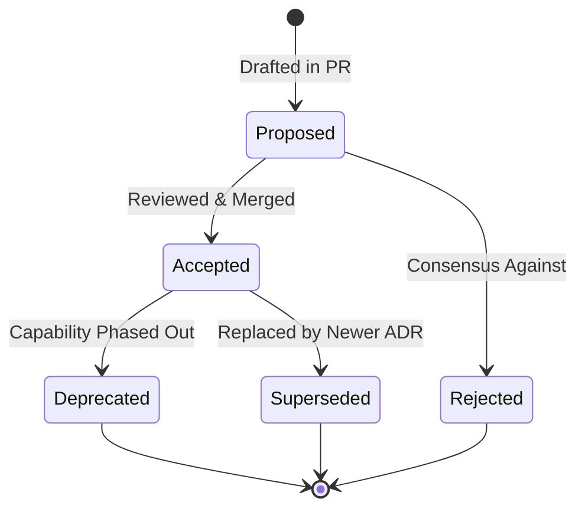

# Architecture Decision Records (ADRs)

This directory contains immutable records of architecturally significant decisions made for **Phone and Email Scraper**. ADRs document the *why* behind technical choices so engineers and AI agents can evaluate trade-offs with full historical context.

---

## ADR Index

| ADR | Title | Status | Date |
|---|---|---|---|
| [ADR-000](./ADR-000-template.md) | Architecture Decision Record Template | Template | 2026-11-22 |
| [ADR-001](./ADR-001-headless-browser-scraping-with-puppeteer.md) | Headless Browser Scraping with Puppeteer | Accepted | 2026-11-22 |
| [ADR-002](./ADR-002-dns-preflight-validation-and-fault-isolation.md) | DNS Pre-Flight Validation & Fault Isolation | Accepted | 2026-11-22 |
| [ADR-003](./ADR-003-append-mode-csv-persistence.md) | Append-Mode CSV Persistence via `csv-writer` | Accepted | 2026-11-22 |
| [ADR-004](./ADR-004-rest-api-and-interactive-openapi-docs.md) | Express REST API with Built-In Interactive OpenAPI (Swagger UI) Documentation | Accepted | 2026-11-22 |

---

## ADR Lifecycle

### Governance Rules
- **Never rewrite an Accepted ADR**: If architectural requirements change, author a new ADR and update the older ADR's status to `Superseded by ADR-XXX`.
- **Keep the index current**: Every new ADR PR must update the table above.
