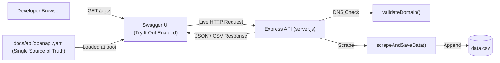

# Interactive API Documentation & Walkthrough

*Status*: Living API Reference  
*OpenAPI Spec*: [`docs/api/openapi.yaml`](./openapi.yaml)  
*Server Entry Point*: [`server.js`](../../server.js)

---

## 1. Zero-Tool Interactive Testing (Built-in Swagger UI)

You do **not** need Postman, Thunder Client, or Insomnia to test the API. The server bundles an interactive **Swagger UI** powered directly by [`docs/api/openapi.yaml`](./openapi.yaml) with **Try it out** pre-enabled.

### Start the Server
```bash
npm start
# or
node server.js
```

### Open the Interactive Playground
- **Swagger UI**: [http://localhost:3000/docs](http://localhost:3000/docs) (root `/` redirects automatically)
- **OpenAPI JSON**: [http://localhost:3000/docs/openapi.json](http://localhost:3000/docs/openapi.json)
- **OpenAPI YAML**: [http://localhost:3000/docs/openapi.yaml](http://localhost:3000/docs/openapi.yaml)



### How to Test in Swagger UI (3 Clicks)
1. Open [http://localhost:3000/docs](http://localhost:3000/docs).
2. Expand any endpoint (for example, **`POST /api/validate-domain`** or **`POST /api/scrape`**).
3. Select a pre-filled example from the dropdown (or edit the JSON body) and click **Execute** — live HTTP status, headers, response duration, and formatted JSON appear inline.

---

## 2. Endpoint Reference & Walkthrough

| Method | Endpoint | Purpose | Launches Chromium? |
|---|---|---|---|
| `GET` | `/api/health` | Liveness check & default scraper settings | No |
| `POST` | `/api/validate-domain` | Validate URL syntax & DNS resolvability | No |
| `POST` | `/api/scrape` | Scrape a single website's contact pages | Yes |
| `POST` | `/api/scrape/batch` | Scrape multiple websites sequentially | Yes |
| `GET` | `/api/results` | Read saved `data.csv` rows (JSON or `?format=csv`) | No |
| `DELETE` | `/api/results` | Truncate/clear `data.csv` after testing | No |

---

### Step 1: Verify Service Health (`GET /api/health`)

Confirm the API server is running and inspect default paths and timeouts.

```bash
curl http://localhost:3000/api/health
```

**Response (`200 OK`):**
```json
{
  "status": "ok",
  "service": "phone-and-email-scraper",
  "uptimeSeconds": 12,
  "nodeVersion": "v20.12.0",
  "defaults": {
    "paths": ["/contact", "/contact-us"],
    "timeoutMs": 30000
  },
  "timestamp": "2026-11-22T01:50:00.000Z"
}
```

---

### Step 2: Pre-Flight Domain Validation (`POST /api/validate-domain`)

Test whether a URL has a valid `http://` or `https://` scheme and resolves in DNS before spending time launching headless Chromium.

```bash
curl -X POST http://localhost:3000/api/validate-domain \
  -H "Content-Type: application/json" \
  -d '{"url": "https://example.com"}'
```

**Response (`200 OK` — Valid):**
```json
{
  "valid": true,
  "url": "https://example.com",
  "hostname": "example.com",
  "address": "93.184.216.34"
}
```

**Response (`200 OK` — Invalid/Unresolvable):**
```json
{
  "valid": false,
  "url": "https://nonexistent.invalid",
  "hostname": "nonexistent.invalid",
  "error": "DNS lookup failed for nonexistent.invalid: ENOTFOUND"
}
```

---

### Step 3: Scrape a Single Website (`POST /api/scrape`)

Scrape a single base URL. You can customize `paths`, `timeout`, and set `saveToCsv: false` to test extraction without modifying `data.csv`.

```bash
curl -X POST http://localhost:3000/api/scrape \
  -H "Content-Type: application/json" \
  -d '{
    "url": "https://example.com",
    "paths": ["/contact", "/contact-us"],
    "timeout": 15000,
    "saveToCsv": false
  }'
```

**Response (`200 OK`):**
```json
{
  "url": "https://example.com",
  "scrapedAt": "2026-11-22T01:52:10.123Z",
  "savedToCsv": false,
  "csvFile": null,
  "results": [
    {
      "pageUrl": "https://example.com/contact",
      "status": "success",
      "phoneNumbers": [],
      "emails": []
    },
    {
      "pageUrl": "https://example.com/contact-us",
      "status": "success",
      "phoneNumbers": [],
      "emails": []
    }
  ]
}
```

---

### Step 4: Batch Scrape Multiple Websites (`POST /api/scrape/batch`)

Submit an array of URLs for sequential, fault-isolated scraping. Invalid domains are marked `skipped` without interrupting valid URLs.

```bash
curl -X POST http://localhost:3000/api/scrape/batch \
  -H "Content-Type: application/json" \
  -d '{
    "urls": ["https://example.com", "https://nonexistent.invalid"],
    "saveToCsv": true
  }'
```

**Response (`200 OK`):**
```json
{
  "total": 2,
  "succeeded": 1,
  "skipped": 1,
  "failed": 0,
  "savedToCsv": true,
  "items": [
    {
      "url": "https://example.com",
      "status": "completed",
      "scrapedAt": "2026-11-22T01:53:01.000Z",
      "results": [ ... ]
    },
    {
      "url": "https://nonexistent.invalid",
      "status": "skipped",
      "reason": "DNS lookup failed for nonexistent.invalid: ENOTFOUND",
      "results": []
    }
  ]
}
```

---

### Step 5: Inspect or Download Saved Results (`GET /api/results`)

Retrieve all records currently persisted in `data.csv` as structured JSON:

```bash
curl http://localhost:3000/api/results
```

Or download the raw CSV directly:

```bash
curl "http://localhost:3000/api/results?format=csv" -o exported.csv
```

---

### Step 6: Reset Output File After Testing (`DELETE /api/results`)

Clear `data.csv` back to an empty file so scraped PII is never accidentally committed:

```bash
curl -X DELETE http://localhost:3000/api/results
```

---

## 3. Error Handling Reference

| HTTP Status | Meaning | Typical Cause |
|---|---|---|
| `400 Bad Request` | Payload validation failed | Missing `url` / `urls`, non-array `paths`, or `timeout` outside `1000–120000` ms |
| `422 Unprocessable Entity` | Domain pre-flight failed | Malformed URL, non-HTTP(S) protocol, or unresolvable DNS hostname |
| `500 Internal Server Error` | Unhandled runtime failure | Chromium launch failure or filesystem permission error |
