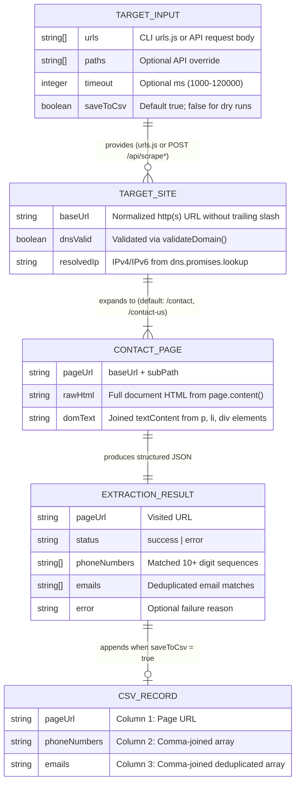

# Data Models & Extraction Pipeline

*Status*: Living Architecture Specification  
*Last Updated*: 2026-11-22

## 1. Overview

This document defines the input data contracts (CLI `urls.js` and REST API JSON payloads), the two-stage contact extraction pipeline inside Puppeteer, and the output persistence & retrieval schemas (`data.csv` and `GET /api/results`).

For full OpenAPI 3.0.3 JSON schemas and interactive examples, see [`docs/api/openapi.yaml`](../api/openapi.yaml) and [`docs/api/README.md`](../api/README.md).

---

## 2. Logical Data Schema

---

## 3. Input Contracts

### A. CLI Static Input (`urls.js`)

| Field | Type | Constraints | Example |
|---|---|---|---|
| `urls` | `string[]` | Must use `http://` or `https://`. Trailing slashes and whitespace are normalized by `validateDomain()`. | `"https://example.com"` |

### B. REST API Input (`server.js` / `openapi.yaml`)

| Endpoint | Required Body Fields | Optional Fields |
|---|---|---|
| `POST /api/validate-domain` | `url: string` | — |
| `POST /api/scrape` | `url: string` | `paths: string[]`, `timeout: 1000–120000`, `saveToCsv: boolean` |
| `POST /api/scrape/batch` | `urls: string[]` (min 1) | `paths: string[]`, `timeout: 1000–120000`, `saveToCsv: boolean` |

---

## 4. Extraction Pipeline

Phone numbers and email addresses are extracted from **different representations** of the loaded page:

```mermaid
flowchart LR
    Page["Loaded Chromium Page<br/>(waitUntil: domcontentloaded)"]
    Page --> RawHTML["page.content()<br/>(Full Serialized HTML)"]
    Page --> DOMQuery["page.evaluate()<br/>querySelectorAll('p, li, div')"]

    RawHTML --> PhoneRegex["Regex: /\\d{10,}/g"]
    PhoneRegex --> PhoneArray["phoneNumbers: string[]<br/>(Not deduplicated)"]

    DOMQuery --> JoinText["element.textContent.join(' ')"]
    JoinText --> EmailRegex["Regex: /\\b[A-Za-z0-9._%+-]+@[A-Za-z0-9.-]+\\.[A-Z|a-z]{2,}\\b/g"]
    EmailRegex --> Dedup["Array.filter(indexOf === index)"]
    Dedup --> EmailArray["emails: string[]<br/>(Deduplicated)"]

    PhoneArray --> Result["Structured JSON Result<br/>(Returned to API caller)"]
    EmailArray --> Result
    Result -- "saveToCsv !== false" --> CsvWriter["csv-writer (append: true)"]
    CsvWriter --> Disk[("data.csv")]
    Disk -- "GET /api/results" --> Parser["RFC-4180 CSV Reader<br/>(JSON or ?format=csv)"]
```

### Extraction Rules Detail

| Artifact | Source | Pattern | Deduplicated | Known Trade-offs |
|---|---|---|---|---|
| **Phone Numbers** | Raw HTML (`page.content()`) | `/\d{10,}/g` | No | Matches any sequence of 10+ consecutive digits, including timestamps or numeric tokens, and ignores formatted numbers with spaces, dashes, or parentheses (e.g., `+1 (555) 123-4567`). |
| **Email Addresses** | DOM text (`p, li, div`) | `/\b[A-Za-z0-9._%+-]+@[A-Za-z0-9.-]+\.[A-Z\|a-z]{2,}\b/g` | Yes | Excludes emails inside `<a>` (unless nested in `p/li/div`), ``, `<footer>`, or `mailto:` `href` attributes when link text differs from the address. |

---

## 5. Output Schema (`data.csv` & `GET /api/results`)

Records are appended via `csv-writer`'s `createObjectCsvWriter` with `append: true`, and can be read back as structured JSON (or raw CSV via `?format=csv`) through `GET /api/results`.

| Column Index | Header Title | Object Property (`id`) | Runtime Type | Serialized CSV Format |
|---|---|---|---|---|
| 1 | `Page URL` | `pageUrl` | `string` | Plain URL string (e.g., `https://example.com/contact`) |
| 2 | `Phone Numbers` | `phoneNumbers` | `string[]` | Comma-separated, quoted by `csv-writer` when multiple values exist (e.g., `"1234567890,9876543210"`) |
| 3 | `Emails` | `emails` | `string[]` | Comma-separated deduplicated list, quoted when multiple values exist (e.g., `"info@example.com,sales@example.com"`) |

### Persistence Behavior Notes
- **Header Row Behavior**: With `append: true`, `csv-writer` does not write a header row when `data.csv` is empty. `GET /api/results` handles both headerless files and files with a seeded `Page URL,Phone Numbers,Emails` header row.
- **Dry-Run Mode**: API callers can pass `"saveToCsv": false` to inspect extracted JSON without writing to `data.csv`.
- **Crash Resilience**: When `saveToCsv` is enabled, `csvWriter.writeRecords([data])` flushes after each page so prior records survive mid-batch interruption.
