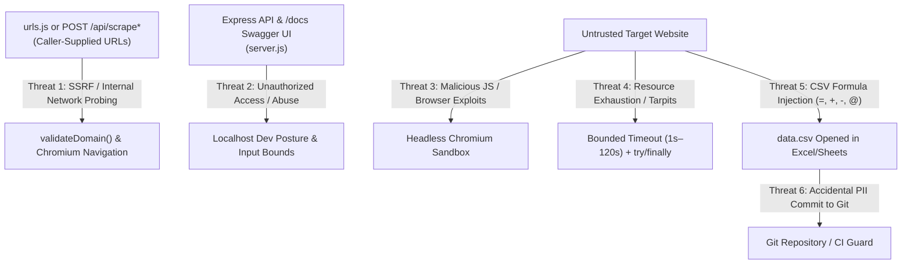

# Security Architecture, Threat Model & Compliance

*Status*: Living Architecture Specification  
*Last Updated*: 2026-11-22

## 1. Overview

**Phone and Email Scraper** drives a headless Chromium browser against untrusted external URLs, exposes a local Express REST API with live Swagger UI (`server.js`), and persists personal contact information (emails and phone numbers). This document defines the threat model, active mitigations, and compliance obligations.

---

## 2. Threat Model & Attack Surface

### Threat Matrix & Mitigations

| Threat | Vector | Current Mitigation | Recommended Hardening (If Exposed Beyond Localhost) |
|---|---|---|---|
| **Chromium / Renderer Exploits** | Malicious JavaScript or media payloads on scraped websites | Puppeteer launches Chromium with default OS sandboxing enabled | Keep `puppeteer` updated (`npm audit`); never pass `--no-sandbox` on a host workstation. |
| **SSRF / Internal Network Access** | Private IP (`127.0.0.1`, `10.0.0.0/8`, `169.254.169.254`) or `file://` URL sent to `POST /api/scrape` | `validateDomain()` strictly restricts schemes to `http://` and `https://` | Block RFC 1918, loopback, and link-local IP ranges returned by `dns.lookup()` before launching Chromium. |
| **Unauthenticated API / Destructive Endpoints** | Open `POST /api/scrape/batch` or `DELETE /api/results` | Intended for local developer workstations (`http://localhost:3000`) | Add API key/JWT authentication, per-IP rate limiting, and disable Swagger UI in production builds. |
| **Resource Exhaustion (DoS)** | Slow tarpit servers or oversized payloads | Express JSON body capped at `1mb`; API `timeout` bounded to `1000–120000` ms; `browser.close()` guaranteed in `try/finally` | Enforce max `urls` array length on `/api/scrape/batch` and move batch jobs to an async worker queue. |
| **CSV Formula Injection** | Malicious webpage embedding strings starting with `=`, `+`, `-`, `@` | Phone regex (`/\d{10,}/g`) and email regex constrain matched character sets | Neutralize leading formula characters if raw text fields are ever added to CSV output. |
| **PII / Secret Leakage in VCS** | Committing populated `data.csv`, `.env`, or diagnostic logs | Hardened [`.gitignore`](../../.gitignore), `DELETE /api/results` cleanup endpoint, and CI check in [`.github/workflows/ci.yml`](../../.github/workflows/ci.yml) verifying `data.csv` is empty | Store production scrape outputs outside the git working tree. |

---

## 3. Ethical Scraping & Legal Compliance

Operators using either the CLI or REST API are responsible for complying with applicable laws and website terms:

1. **Respect `robots.txt` and Terms of Service**: Verify that target domains permit automated access before scraping.
2. **Rate Limiting & Politeness**: Both CLI and `POST /api/scrape/batch` execute sequentially, naturally limiting concurrency. Do not flood a single host with parallel API requests.
3. **Data Privacy (GDPR, CCPA, POPIA, ePrivacy)**:
   - Personal email addresses and direct phone numbers constitute **Personally Identifiable Information (PII)**.
   - Ensure a lawful basis before collecting, storing, or contacting individuals derived from scraped data.
   - Use `"saveToCsv": false` during API development/testing, or call `DELETE /api/results` afterward so PII is never committed.

---

## 4. Zero-Leak Repository Controls

- **Hardened `.gitignore`**: Excludes `.env*`, private keys (`*.pem`, `*.key`, `id_rsa*`), runtime logs (`*.log`), heap dumps, and OS/IDE noise.
- **Automated CI Gate**: [`.github/workflows/ci.yml`](../../.github/workflows/ci.yml) runs `gitleaks` on every push/PR and fails builds if `data.csv` is non-empty.
- **Vulnerability Disclosure**: Follow [`SECURITY.md`](../../SECURITY.md) for responsible reporting.
