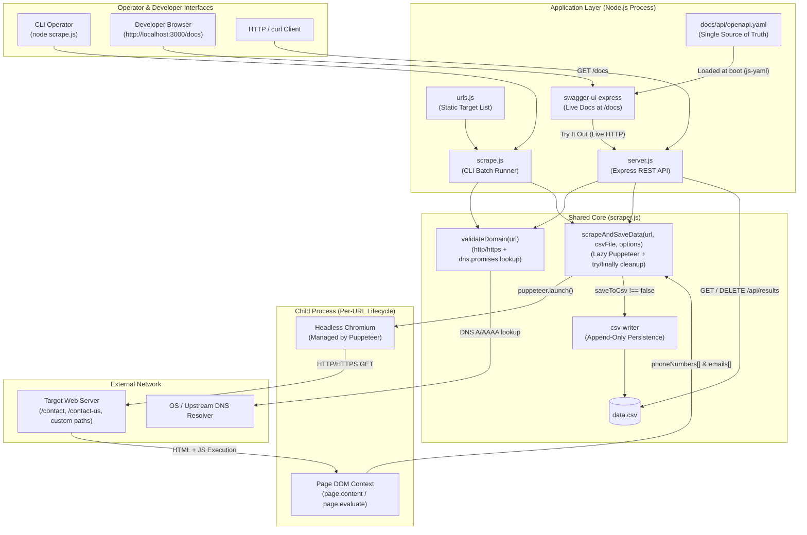
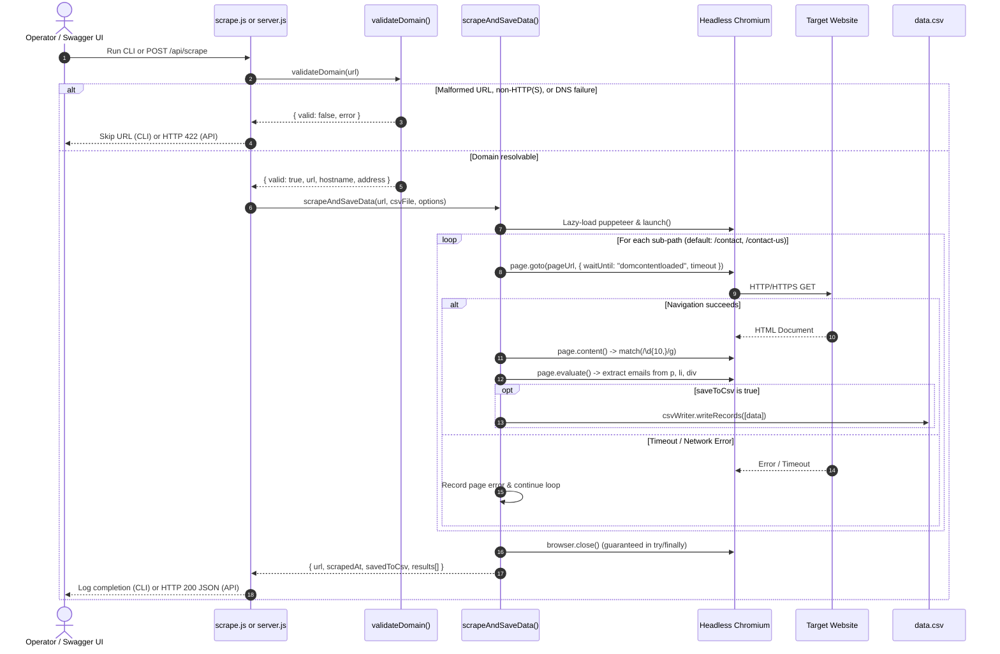
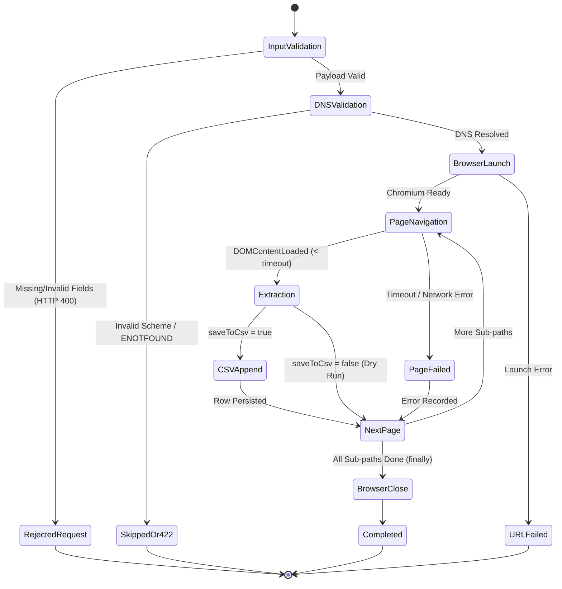

# System Design & Component Topology

*Status*: Living Architecture Specification  
*Last Updated*: 2026-11-22

## 1. Overview

**Phone and Email Scraper** supports two execution surfaces over a shared scraping and validation core ([`scraper.js`](../../scraper.js)):

1. **CLI Batch Mode** ([`scrape.js`](../../scrape.js)): Reads a static list of URLs from [`urls.js`](../../urls.js) and scrapes them sequentially.
2. **REST API & Live Interactive Docs Mode** ([`server.js`](../../server.js)): Exposes HTTP endpoints via Express and serves an interactive **Swagger UI** playground at `GET /docs` directly from [`docs/api/openapi.yaml`](../api/openapi.yaml) so developers can test endpoints live without Postman or Thunder Client.

Both modes share pre-flight URL/DNS validation (`validateDomain`), headless Chromium extraction (`scrapeAndSaveData`), and append-mode CSV persistence (`data.csv`).

---

## 2. Component Topology

---

## 3. End-to-End Execution Sequence

The sequence below covers both CLI batch execution and live Swagger UI / REST API execution:

---

## 4. Module Boundaries & Contracts

| Module | Role | Exports / Entry Point | Dependencies |
|---|---|---|---|
| [`server.js`](../../server.js) | Express REST API & live Swagger UI server (`/docs`) | `{ app }` + self-listening CLI (`npm start`) | `express`, `swagger-ui-express`, `js-yaml`, `./scraper`, `docs/api/openapi.yaml` |
| [`scrape.js`](../../scrape.js) | CLI batch orchestrator | Self-executing CLI (`npm run scrape` / `node scrape.js`) | `./scraper`, `./urls` |
| [`scraper.js`](../../scraper.js) | Shared DNS validator, Puppeteer controller & CSV writer | `{ DEFAULT_PATHS, DEFAULT_TIMEOUT_MS, validateDomain, scrapeAndSaveData }` | `puppeteer` (lazy-loaded), `csv-writer`, `dns.promises` |
| [`urls.js`](../../urls.js) | Static input configuration for CLI mode | `{ urls: string[] }` | None |
| [`docs/api/openapi.yaml`](../api/openapi.yaml) | Single-source-of-truth OpenAPI 3.0.3 contract | Loaded by `server.js` into Swagger UI | None |

### Internal Function Contracts

- **`validateDomain(rawUrl: string)`** (`scraper.js`):
  - Enforces non-empty string, valid WHATWG `URL`, and `http:` / `https:` protocol only.
  - Resolves hostname via `dns.promises.lookup` and returns `{ valid, url, hostname?, address?, error? }`.
- **`scrapeAndSaveData(url, csvFile = "data.csv", options = {})`** (`scraper.js`):
  - Supports `{ paths?: string[], timeout?: number, saveToCsv?: boolean }`.
  - Lazy-loads `puppeteer` on first scrape call so non-scraping API endpoints (`/api/health`, `/api/validate-domain`, `/api/results`, `/docs`) start instantly.
  - Guarantees `await browser.close()` inside a `try/finally` block and returns structured per-page extraction results.

---

## 5. Fault Isolation & Error State Model

### Scaling Characteristics
- **Per-URL Browser Lifecycle**: Launching and closing Chromium per URL maximizes session/cookie isolation between sites at the cost of higher CPU/RAM overhead on large batches.
- **Synchronous HTTP Batch Execution**: `POST /api/scrape/batch` processes URLs sequentially within the HTTP request lifecycle; for very large batches in production, an asynchronous job queue should be introduced via a future ADR.
