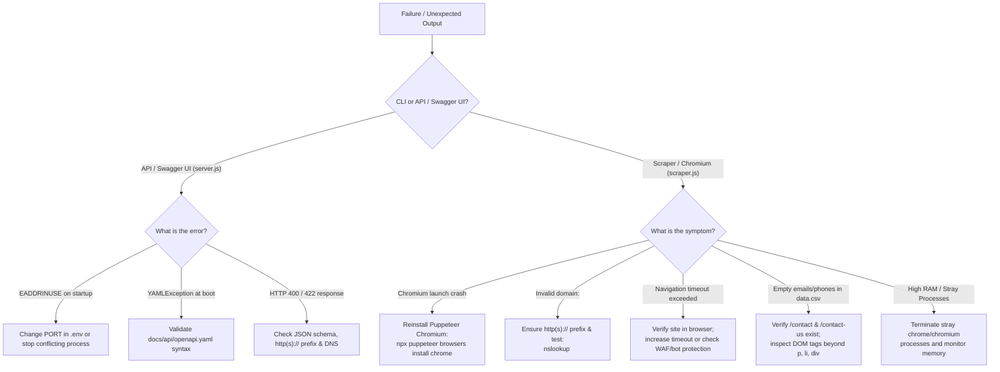

# Troubleshooting & Incident Response Runbook

*Tier 4 Operational Runbook*  
*Last Updated*: 2026-11-22

Use this runbook to diagnose and resolve runtime failures across both the CLI (`scrape.js`) and the REST API / live Swagger UI (`server.js`).

---

## 1. Failure Triage Flowchart



---

## 2. Common Failure Playbooks

### A. API Server Fails with `EADDRINUSE`
- **Symptoms**: `Error: listen EADDRINUSE: address already in use :::3000` when running `npm start`.
- **Resolution**:
  - Start on an alternate port:
    ```powershell
    # Windows PowerShell
    $env:PORT=3001; npm start
    ```
    ```bash
    # Linux / macOS
    PORT=3001 npm start
    ```

### B. Swagger UI Fails to Boot (`YAMLException`)
- **Symptoms**: `server.js` throws a `YAMLException` when loading [`docs/api/openapi.yaml`](../api/openapi.yaml).
- **Resolution**:
  - Validate the OpenAPI YAML locally:
    ```bash
    node -e "const fs=require('fs'), yaml=require('js-yaml'); yaml.load(fs.readFileSync('docs/api/openapi.yaml','utf8')); console.log('YAML OK')"
    ```

### C. HTTP `400 Bad Request` or `422 Unprocessable Entity` from API
- **Symptoms**: `POST /api/scrape` returns `400` or `422` in Swagger UI.
- **Root Causes**:
  - `400`: Missing `url`/`urls`, non-array `paths`, or `timeout` outside `1000–120000` ms.
  - `422`: URL lacks `http://`/`https://` or hostname failed DNS lookup. Test first with `POST /api/validate-domain`.

### D. Puppeteer Fails to Launch Chromium
- **Symptoms**: `Error: Could not find Chrome` or missing shared library errors on Linux (`libnss3.so`, `libgbm.so`).
- **Resolution**:
  1. Re-download the managed browser binary:
     ```bash
     npx puppeteer browsers install chrome
     ```
  2. On Debian/Ubuntu Linux servers, install required Chromium system libraries (`libnss3`, `libatk1.0-0`, `libgbm1`, `libasound2`).

### E. `Invalid domain: <url>` / Skipped URLs
- **Symptoms**: `scrape.js` logs `Invalid domain:` or `POST /api/validate-domain` returns `valid: false`.
- **Diagnostics**:
  ```bash
  node -e "require('dns').promises.lookup('example.com').then(console.log).catch(console.error)"
  ```

### F. `Failed to scrape <url>: Navigation timeout of 30000 ms exceeded`
- **Symptoms**: Puppeteer aborts navigation after the configured timeout and moves to the next page.
- **Resolution**:
  - Verify target reachability manually (check for WAF/anti-bot challenges).
  - Pass a higher `timeout` (up to `120000` ms) in `POST /api/scrape` or adjust `DEFAULT_TIMEOUT_MS` in [`scraper.js`](../../scraper.js).

### G. Missing Emails or False-Positive Phone Numbers in `data.csv`
- **Symptoms**: Expected emails are absent, or long numeric IDs appear under `Phone Numbers`.
- **Resolution**:
  - Review [`docs/architecture/data-model.md`](../architecture/data-model.md) for current extraction rules.
  - Test custom paths interactively via `POST /api/scrape` with `"paths": ["/", "/about", "/contact"]` and `"saveToCsv": false`.

### H. Orphaned Headless Chromium Processes
- **Symptoms**: High CPU/memory usage after force-killing Node.js (`SIGKILL` / Task Manager).
- **Diagnostics & Cleanup**:
  ```powershell
  # Windows PowerShell
  Get-Process chrome -ErrorAction SilentlyContinue
  ```
  ```bash
  # Linux / macOS
  ps aux | grep -i chrome
  ```
